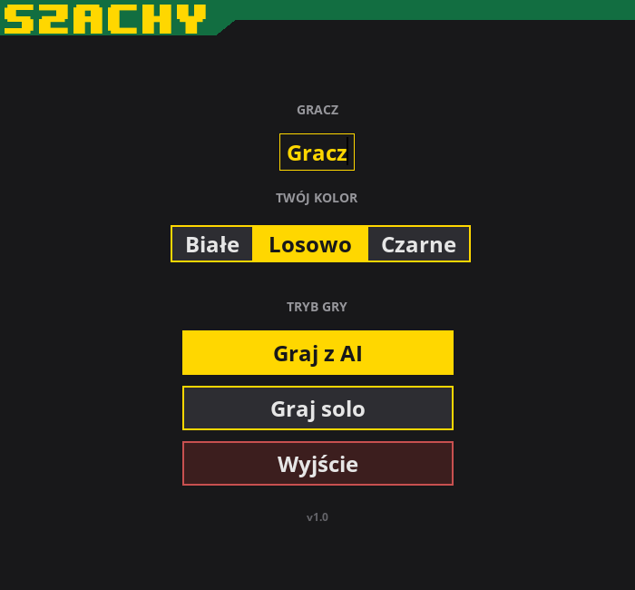
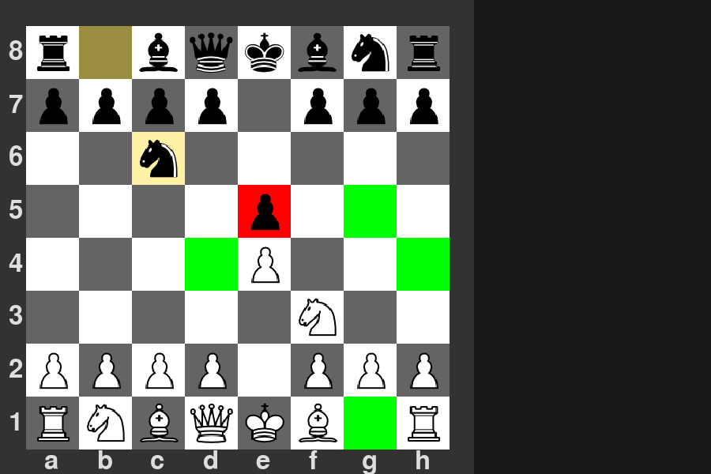
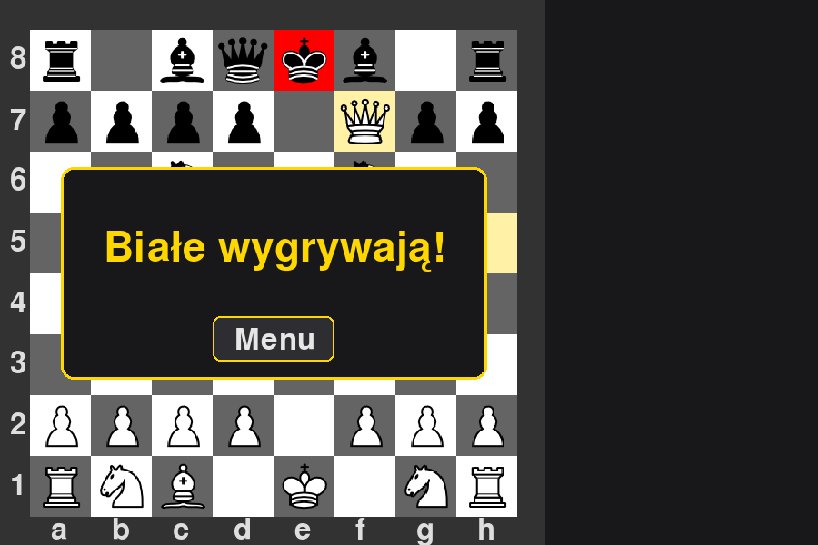

# Chess: Python and Pygame

A desktop chess game with a minimax AI, written from scratch in Python. The rules engine and the move generator are my own code, with no chess libraries.


| Start menu | Game | Checkmate |
|---|---|---|
|  |  |  |

## Features

**Game**
- Full rules: all piece movements, check, checkmate, stalemate, castling, en passant and pawn promotion
- Modes: play against the AI, or play both sides on one board
- Choose your colour (white, black or random). The board is oriented towards your side

**Interface**
- Drag and drop pieces with the mouse
- Legal moves are highlighted: green for a move, red for a capture
- The last move and the king in check are highlighted
- Styled start menu, game-over dialog and promotion dialog

**AI**
- Minimax search with alpha-beta pruning (depth 3)
- Moves are searched captures first (most valuable victim first), so alpha-beta prunes more branches
- Evaluation = material (pawn 1, knight/bishop 3, rook 5, queen 9) + piece-square tables
- Separate piece-square tables for the opening, middlegame and endgame; the phase is detected from the material left on the board
- Mate scores take distance into account, so the AI prefers the fastest mate and the slowest loss
- Stalemate is scored as a draw

**Quality**
- Unit tests with `pytest` for the move rules, castling rights, en passant, promotion and mate detection

## Getting started

Requires Python 3.10 or newer.

```bash
git clone https://github.com/rokrerum/chess-multiplayer.git
cd chess-multiplayer

python -m venv .venv
source .venv/bin/activate        # Windows: .venv\Scripts\activate

pip install -r requirements.txt
python main.py
```

Run the tests:

```bash
pip install pytest
pytest
```

## How to play

1. Enter your name and choose your colour in the start menu, then pick a mode: **Graj z AI** (against the computer) or **Graj solo** (both sides on one board).
2. Press and hold the left mouse button on a piece to see its legal moves.
3. Drag the piece to a highlighted square and release.
4. When a pawn reaches the last row, pick the piece to promote to.

## Project structure

```
main.py          Pygame interface: menu, board drawing, game loop
chess.py         Rules: move generation, check, checkmate and stalemate detection
chess_ai.py      AI: minimax with alpha-beta pruning and the evaluation function
assets/          Piece images
docs/            Screenshots used in this README
test_chess.py    pytest test suite
```

## How the AI works

The board is an 8x8 list of lists. Lowercase letters are white pieces, uppercase letters are black.

1. **Move generation** (`chess.py`): every piece produces candidate moves, and each candidate is played on a copy of the board. A move is legal only if it does not leave the mover's own king in check.
2. **Search** (`chess_ai.py`): minimax looks three plies ahead. The AI maximises the score, the opponent minimises it. Alpha-beta pruning skips branches that cannot change the result, and capturing moves are tried first so cut-offs happen early.
3. **Evaluation**: material plus the piece-square bonus for the current game phase. Checkmate scores about ±1,000,000, adjusted by search depth so that quicker mates are preferred.

## Roadmap

- [ ] Draw rules: threefold repetition, fifty-move rule, insufficient material
- [ ] Difficulty levels (search depth chosen in the menu)
- [ ] Move list in algebraic notation and captured pieces
- [ ] Run the AI in a separate process so the window never freezes
- [ ] Online multiplayer
- [ ] Sound effects

## License

MIT, see [LICENSE](LICENSE).
